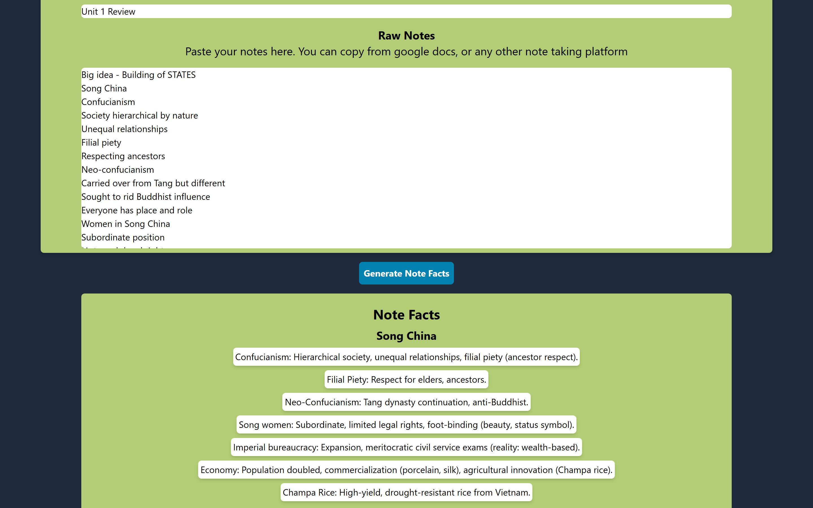
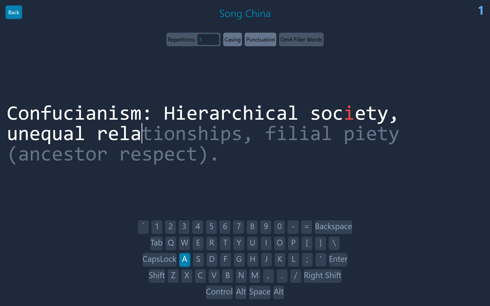

# Notes Review App

Paste in your class notes. An LLM (Google Gemini) turns them into short facts, and you memorize them by typing each one over and over in a Monkeytype-style typing test. Quizlet meets Monkeytype meets ChatGPT.

**Live site:** https://bruce-peters.github.io/notes-review-app/ (sign in with Google or an email account)

| Edit a note set | Typing practice |
|---|---|
|  |  |

## Features

- Sign in with Google or with email and password (Firebase Authentication).
- Note sets are saved per user in Cloud Firestore. `firestore.rules` lets each user read and write only their own data.
- Paste raw notes (bulleted lists copied from Google Docs work well), then click **Generate Note Facts**. Gemini splits them into sections of very short facts, and you can edit the facts before saving.
- Typing practice: each fact is shown letter by letter with correct, incorrect, and extra-character highlighting, plus an on-screen keyboard.
  - **Enter** counts one repetition (3 per fact by default). **Ctrl+Enter** skips to the next fact.
  - Toggles for casing, punctuation, and omitting filler words.

## How the LLM is called

There is no backend. `src/api/index.js` calls the Gemini API **directly from the browser** with the `@google/generative-ai` SDK. It uses the model `gemini-3.5-flash` and falls back to `gemini-3.5-flash-lite` when the first model is overloaded or rate-limited. The API key comes from the `VITE_GEMINI_API_KEY` build-time env var.

Because the key is used in the browser, it ends up in the built JavaScript. Anyone who opens the site can read it.

## Run it locally

**Prerequisites:** Node.js 18+ and npm. Emulator mode needs more: Node.js 20+ and Java 21 (current `firebase-tools` requires both; tested with Node 22 and OpenJDK 21).

```bash
git clone https://github.com/bruce-peters/notes-review-app.git
cd notes-review-app
npm ci
cp .env.example .env      # then put your Gemini key in VITE_GEMINI_API_KEY
npm run dev               # http://localhost:5173/notes-review-app/
```

- Get a free Gemini key at https://aistudio.google.com/apikey. Without a key the app still runs, but **Generate Note Facts** shows "No Gemini API key configured."
- `npm run dev` talks to the real Firebase project (`note-reviewer`) configured in `src/firebase/index.js`. A Firebase web config is meant to be public, so this is not a secret.

### Offline with the Firebase emulators (no accounts needed)

Run these in three terminals:

```bash
npm run emulators         # Auth + Firestore emulators (downloads them via npx firebase-tools on first run)
npm run seed              # creates a demo user and two note sets
npm run dev:emulators     # app pointed at the emulators (uses .env.emulators)
```

Sign in at `#/login` with `demo@notes-review.test` / `emulator-demo-7f3k2q`. That account exists only in the local emulator; see `scripts/seed-emulators.mjs`.

### Tests, lint, build

```bash
npm test                  # builds first (pretest), then runs Jest + React Testing Library in src/tests/
npm run build             # production build into dist/
npm run preview           # serve the build
npm run lint
```

The tests mock Firebase and Gemini, so they run offline. `npm run lint` still reports some older warnings and errors in the app code.

## Using your own Firebase project (free Spark plan)

> Not run end-to-end here (it needs a Google account).

1. Create a project in the [Firebase console](https://console.firebase.google.com/) and add a Web app.
2. Copy the app's config object into `firebaseConfig` in `src/firebase/index.js`, and set the project id in `.firebaserc`.
3. In **Authentication → Sign-in method**, enable **Email/Password** and **Google**. Add the domain you deploy to (for example `<user>.github.io`) under **Authentication → Settings → Authorized domains**.
4. Create a **Cloud Firestore** database, then deploy the rules: `npx firebase-tools deploy --only firestore:rules`.

## Deploy (GitHub Pages)

`npm run deploy` builds the app and publishes `dist/` to the `gh-pages` branch with the `gh-pages` package. The site is served from `/notes-review-app/` (`config.js` sets `BASE_PATH`). Make sure `.env` holds the Gemini key before deploying, because Vite bakes it into the bundle at build time.

## Project structure

```
src/
  api/index.js          # Gemini call (client-side) + model fallback
  firebase/index.js     # Firebase config, Auth, Firestore, emulator switch
  pages/                # Home, Login, EditNoteSet (generate/edit facts), TypeNotes (typing practice)
  components/           # DisplayText, Keyboard, NoteSetCard, NoteSetsView, Layout
  state/                # AuthContext, useNoteSet, useNoteSets (Firestore reads/writes)
  tests/                # Jest tests
scripts/seed-emulators.mjs  # demo data for the emulators
firestore.rules         # per-user access rules
```

## The idea

This is a simple app that I developed over the course of a few weeks to solve a simple study problem

The original idea for this app was to create an app like quizlet that could help me study.
I had used quizlet in the past but it was only realy useful for me in classes like spanish, where one only needs to remember how to translate a few words (aka. only simple memorization)
I also realized that the best way that I found to learn this using quizlet was throught their Write Mode.
At the same time I was starting to use another website called Monkeytype more and more (the thought being that I would be able to type faster and thus take notes faster for humanities classes like AP World)
Then it hit me: What if I made an app that would allow you to memorize facts using a typing test like format.
In one of my hardest classes at the time AP World, I was struggling to remember all of the facts that we were learning and to synthesize my notes.
So I came up with a plan for this app. Take notes, extract raw facts out of them, and then put that into a typing test to help people memorize them.
I made a simple moc up, and it worked.
So, I decided to finish making the app and after some prompt engineering and perserveerence, I made it


(I know there are typos i'm to lazy to fix them)
